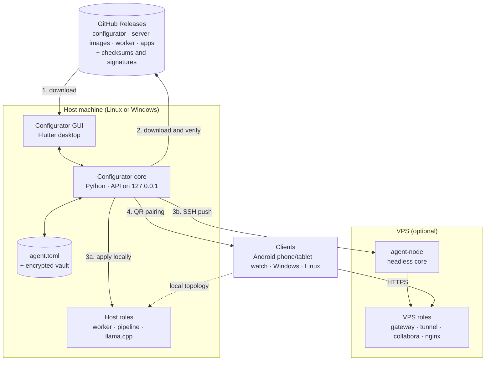
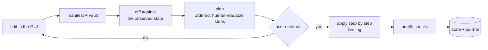

# Configurator: design and roadmap

> Status: **design agreed, not implemented** · 2026-11-12
> Scope: turning the current single-owner installation into a product that anyone can install, configure and
> operate from one graphical program, and preparing the public repository.

This document records every decision taken so far, the target architecture, the changes the current codebase
needs, and the order of work. It is the reference for implementation; anything that changes here should be
recorded as a new decision in [section 3](#3-decision-log).

---

## Table of contents

1. [Context](#1-context)
2. [Goals and non-goals](#2-goals-and-non-goals)
3. [Decision log](#3-decision-log)
4. [Core concepts](#4-core-concepts)
5. [Target architecture](#5-target-architecture)
6. [The manifest](#6-the-manifest)
7. [Roles and placement](#7-roles-and-placement)
8. [Plan and apply engine](#8-plan-and-apply-engine)
9. [Topologies in detail](#9-topologies-in-detail)
10. [AI configuration](#10-ai-configuration)
11. [Modules and capabilities](#11-modules-and-capabilities)
12. [Clients and QR pairing](#12-clients-and-qr-pairing)
13. [Distribution and bootstrap](#13-distribution-and-bootstrap)
14. [Required consequences: CI, signing, versioning](#14-required-consequences-ci-signing-versioning)
15. [Security of the configurator](#15-security-of-the-configurator)
16. [Screens](#16-screens)
17. [Refactoring the current project](#17-refactoring-the-current-project)
18. [Public repository preparation (track A)](#18-public-repository-preparation-track-a)
19. [Roadmap](#19-roadmap)
20. [Open questions](#20-open-questions)
21. [Glossary](#21-glossary)

---

## 1. Context

Today the system works, but its configuration is spread across:

- shell scripts (`infra/scripts/instalar_vps`, `atualizar_vps`, `conectar_vps`, `backup`, `publicar_app`);
- several `.env` files (`.env.prd`, `.env.pc`, `plataforma/backend/.env`, `plataforma/worker/.env`);
- values hard-coded for the owner's machines (domain defaults in scripts, the PC's MAC address, paths such as
  `~/development/flutter`, `~/Documents/github/agent`);
- an app build that embeds the server address (`--dart-define=API_URL=…` in `plataforma/app/lib/main.dart`).

It is installable by its author only. To publish the project, installation and operation must be **guided,
automatic and reproducible** for people with very different hardware.

## 2. Goals and non-goals

**Goals**

- One **graphical configurator** is the first and only thing a person downloads; everything else is downloaded
  and installed by it.
- Support three **topologies** (local, hybrid, cloud-only) and three **AI sources** (local, cloud, both).
- Configure *everything* from the configurator: account, TOTP, topology, VPS installation (including nginx and
  TLS), local model downloads, cloud accounts, modules, devices, backup, updates.
- Automatic but transparent: every change is shown as a plan before it runs.
- A single, generic app for all users, paired by QR code.
- Migrate the owner's current installation without reinstalling.

**Non-goals (for now)**

- macOS (no hardware to test on).
- Multi-tenant hosting: the system stays single-user per installation.
- The video pipeline (`esteira`) on Windows.

## 3. Decision log

All accepted on 2026-11-12. To be split into individual ADRs (`docs/adr/NNNN-title.md`) in the public repository.

| ID | Decision | Rationale |
|---|---|---|
| C1 | Configuration is modelled as **two independent axes**: topology and AI source | Mixing both into fixed "modes" made the cases ambiguous |
| C2 | A declarative **manifest** (`agent.toml`) is the single source of truth; secrets live in a separate encrypted **vault** | Reproducible, diffable, safe to back up |
| C3 | Machines receive **roles** (`gateway`, `worker`, `tunnel`, `collabora`, `pipeline`) instead of being special cases | Same code for every topology; only placement changes |
| C4 | The worker **announces capabilities** in `worker_hello`; app and modules adapt to them | Covers partial setups (e.g. 8 GB GPU) without `if mode == …` in the code |
| C5 | **Generic app with QR pairing**; drop `API_URL` embedded at build time | One binary for the public; per-device keys can be revoked |
| C6 | VPS delivery by **both** paths: SSH push from the configurator and an isolated bundle (`agent-node aplicar`) | Some users will not grant SSH access |
| C7 | The configurator is a **separate, polished graphical program** on the host and configures everything | One place to operate the system, no terminal juggling |
| C8 | The configurator is the **entry point**: download it first, it downloads and installs the rest from GitHub Releases | Simple onboarding; one trusted source |
| C9 | Supported platforms: **Linux and Windows**; no macOS for now | Testable hardware only |
| C10 | Cloud-only topology accepts **paid APIs from any provider, including Anthropic**, for other users. The owner keeps using `claude -p` combined with local models | Users choose; the owner's rule is personal, not a product restriction |
| C11 | Local topology supports **LAN only** and an **optional tunnel** for outside access | Both use cases are real |
| C12 | An **adopt** command imports the current installation into a manifest | No reinstall for the owner |
| C13 | Every action is **plan, then apply**: idempotent, resumable, logged | Automatic without surprises |
| C14 | The public project lives in a **new repository with clean history**; this one stays private | Deleted files remain in git history |
| C15 | **CI is mandatory**, artifacts are **signed or checksummed and verified** before install, and components carry a **protocol version** | Consequences of automatic downloads (section 14) |

Accepted on 2026-11-14 (details in section 9.5):

| ID | Decision | Rationale |
|---|---|---|
| C16 | **Only established cryptography** (TLS 1.3, Ed25519, WireGuard, AEAD, Argon2id) through maintained libraries; no custom schemes | Home-made crypto fails; audited standards do not |
| C17 | Web server is a choice: **nginx (default)** in Docker or on the host, or **Apache on the host**, rendered from one neutral route list with the same security level | Many developers run Apache; two hand-written configs would drift |
| C18 | Auth check of internal routes and login rate limiting move **into the gateway** | Apache has no `auth_request`; security must not depend on the web server |
| C19 | **One subdomain per service** (app, docs/Collabora, admin…) instead of paths; local topology uses no domain | Isolation per service and per certificate |
| C20 | **Wildcard certificate** (`*.domain`, DNS-01 with a DNS API token in the vault) by default; per-subdomain HTTP-01 as fallback | Certificate Transparency logs would otherwise publish every subdomain name |
| C21 | PC ↔ VPS over **WireGuard**; internal services listen only on the WireGuard interface | Internal services become invisible from the internet; replaces the reverse SSH tunnel |
| C22 | **mTLS** (per-device client certificate) on the admin subdomain; app uses short-lived JWT with rotating refresh + TOTP | Unenrolled devices cannot even finish the TLS handshake |
| C23 | New topology variant **home with public IP**: the home PC plays the VPS role | Owners with a fixed IP do not need a VPS |

## 4. Core concepts

### 4.1 Topology: where the system runs

| Topology | Machines | For whom | Outside access |
|---|---|---|---|
| **Local** | one PC or laptop (all roles) | trying it out, home-only use | LAN only, or optional tunnel |
| **Hybrid** | VPS + home PC | access from anywhere using the home GPU (owner's setup) | yes, through the VPS |
| **Cloud-only** | VPS only | no capable PC, or PC not always on | yes |

### 4.2 AI source: where inference comes from

| Source | Requires | Provides |
|---|---|---|
| **Local** | NVIDIA GPU | chat, structured JSON, speech, image, embeddings, LoRA |
| **Cloud** | account or API key | chat and structured JSON; speech or image only if the provider offers it |
| **Both** | both | everything, with escalation from local to cloud |

### 4.3 Valid combinations

| | Local AI | Cloud AI | Both |
|---|---|---|---|
| **Local topology** | yes | yes | yes |
| **Hybrid topology** | yes | yes | yes (owner) |
| **Cloud-only topology** | no (VPS has no GPU) | yes | no |

### 4.4 Capabilities

A capability is something a worker can do. The worker detects and announces them; nothing is assumed.

| Capability | Detected from |
|---|---|
| `llm-local` | `llama-server` binary + at least one model |
| `vision` | a model folder with `mmproj-*` |
| `embeddings` | embedding model present |
| `stt` | faster-whisper installed |
| `tts` | XTTS / Kokoro / Piper available |
| `image` | SDXL environment + enough VRAM |
| `claude-code` | `claude` CLI logged in |
| `cloud:<provider>` | configured key or CLI login (`anthropic`, `openai`, `gemini`, `xai`, `deepseek`) |
| `spice` | ngspice binary |
| `craft-apps` | Craft Apps CLIs |
| `repo` | a repository checkout for the Código module |

## 5. Target architecture



### 5.1 Components

| Component | Technology | Responsibility |
|---|---|---|
| **Configurator GUI** | Flutter desktop (keeps decision D1: one UI stack), reuses `app_core` and the theme | screens, wizards, live logs, QR display |
| **Configurator core** | Python, packaged as a standalone executable | manifest, vault, plan/apply engine, SSH, downloads, verification, health checks |
| **agent-node** | the same core without GUI | runs on the VPS: receives the plan by SSH or from an isolated bundle |
| **Worker** | existing `plataforma/worker` | executes tasks; announces capabilities and protocol version |
| **Gateway** | existing `plataforma/backend` | API, auth, pairing, device keys |
| **Clients** | existing `plataforma/app` + watch app | generic build, paired by QR |

One logic, two faces: the GUI never executes anything itself; it calls the core. The VPS runs the same core.
That keeps the SSH path and the isolated-bundle path identical.

### 5.2 Why a separate program and not a screen inside the app

1. It runs **before** any server exists; the app works only after pairing.
2. It holds the most sensitive credentials (VPS SSH key, cloud accounts); the daily app must not.
3. The host is not necessarily the device used daily.

## 6. The manifest

Human-readable, no secrets, versioned by schema. Example for the owner's hybrid setup:

```toml
schema = 1

[account]
user = "owner"
# password hash and TOTP secret live in the vault

[topology]
kind = "hybrid"                  # local | hybrid | cloud
domain = "example.com"           # hybrid and cloud
cloudflare = true

[topology.local]                 # only for kind = "local"
access = "lan"                   # lan | tunnel
tunnel = "cloudflare"            # when access = "tunnel" (see open questions)

[nodes.home]
address = "local"
roles = ["worker", "pipeline"]
data_dir = "~/agent-data"

[nodes.vps]
address = "user@vps.example.com"
delivery = "ssh"                 # ssh | bundle
roles = ["gateway", "tunnel", "collabora"]
data_dir = "/var/lib/agent"

[ai.local]
enabled = true
gpu = "auto"                     # detected; stored after detection
models = ["qwen3-14b", "gemma-4-12b-it", "embeddinggemma-300m"]

[ai.cloud]
enabled = true
providers = ["claude-code"]      # claude-code | anthropic | openai | gemini | xai | deepseek
escalation = "local-first"       # local-first | cloud-first | cloud-only

[modules]
enabled = ["rotinas", "saude", "estudos", "arquivos", "design", "eletronica",
           "codigo", "concursos", "financas", "painel", "empreendimento"]

[backup]
provider = "gdrive"
schedule = "daily"
retention = { daily = 7, weekly = 4, monthly = 12 }

[updates]
channel = "stable"               # stable | beta
source = "github"                # github | self (own VPS)
```

**Vault** (encrypted, never committed): password hash, TOTP secret, JWT key, worker keys, device keys, SSH
private key for the VPS, cloud API keys, OAuth tokens (Google Drive). The vault key is stored in the operating
system keychain (Secret Service on Linux, Credential Manager on Windows).

**Generated files:** from manifest + vault, the core renders each node's `.env`, `docker-compose` profile,
nginx site, systemd units (Linux) or services (Windows). Generated files are never edited by hand.

## 7. Roles and placement

| Role | What runs | Local | Hybrid | Cloud-only |
|---|---|---|---|---|
| `gateway` | FastAPI backend + nginx + certbot | host | VPS | VPS |
| `worker` | worker process | host | home PC | VPS (no GPU, cloud providers only) |
| `tunnel` | reverse SSH for the pipeline API | not needed | VPS | not needed |
| `collabora` | document editing (WOPI) | host (optional) | VPS | VPS |
| `pipeline` | video pipeline (`esteira`) | host (Linux, GPU) | home PC | unavailable |

Placement rules enforced by the core:

- `pipeline` requires `llm-local`, `image` and `craft-apps` on the same node.
- `tunnel` exists only when `gateway` and `pipeline` are on different nodes.
- Local topology with `access = "tunnel"` adds an outbound tunnel client on the host instead of a VPS.

## 8. Plan and apply engine



Properties:

- **Idempotent**: re-applying an unchanged manifest does nothing.
- **Resumable**: each step is recorded; a dropped SSH connection resumes from the last completed step.
- **Observable**: every step streams its log to the GUI and is stored in the journal (Registro screen).
- **Reversible where possible**: generated configs are versioned; a failed apply restores the previous set.
- **Plan example** (new VPS): install Docker · open ports 80/443/2222 · create the `agent` user · install the
  configurator's SSH key and disable password login · check DNS points to the VPS · render nginx for the
  domain · request the TLS certificate · start gateway, tunnel, collabora · register the worker key · run
  health checks.

## 9. Topologies in detail

### 9.1 Local

- All roles on the host; the worker connects to `localhost`.
- `access = "lan"`: the gateway listens on the LAN address; the QR code carries that address. TLS through a
  local certificate authority generated by the configurator (clients trust it during pairing).
- `access = "tunnel"`: an outbound tunnel (Cloudflare Tunnel or Tailscale, see open questions) publishes the
  gateway without opening ports at home.
- Docker is optional on the host; on Windows, server roles run through WSL2 or Docker Desktop.

### 9.2 Hybrid (owner's setup)

- Today's architecture: outbound WebSocket from the PC, nginx (or Apache) and TLS on the VPS, Cloudflare
  optional. The reverse SSH tunnel for the pipeline is replaced by WireGuard (C21).
- Public subdomains point to the VPS; internal services are reached only through WireGuard.
- Migration through **adopt** (section 17.9).

### 9.3 Cloud-only

- Everything on the VPS, including a worker without GPU that only forwards to cloud providers.
- Modules that need local capabilities (pipeline, speech without a cloud provider, local image) are disabled
  with a visible reason.

### 9.4 Home with public IP

- Same roles as the VPS, placed on the home PC; subdomains point to the home IP (fixed, or DDNS later).
- The configurator guides the router port forward: 443 (and 80 only during HTTP-01), or only the WireGuard
  port when every client uses WireGuard. Warns that the home IP becomes public.
- Firewall on the PC opens only those ports; everything else stays on `127.0.0.1` or the WireGuard interface.

### 9.5 Web server, subdomains and transport security

**Web server (C17, C18).** The core keeps one neutral route list per subdomain (upstream, WebSocket, body
limit, auth requirement, security headers) and two renderers: nginx and Apache (`mod_ssl`, `mod_proxy`,
`mod_proxy_http`, `mod_proxy_wstunnel`, `mod_headers`). Mode `auto` detects nginx or Apache already running on
the host; otherwise nginx in Docker. Apache is host-only. Files are named `solumia-<subdomain>.conf`; every
change runs `nginx -t` / `apachectl configtest` first and keeps the previous file on failure.

**TLS (both servers, same profile).** Mozilla *intermediate*: TLS 1.3 plus TLS 1.2 with AEAD ciphers only
(ECDHE + AES-GCM / ChaCha20-Poly1305), no session tickets, HSTS with `includeSubDomains`, the existing
security headers (`seguranca-http.conf`) translated per server; Collabora keeps its required
`frame-ancestors`. Certificates from Let's Encrypt via certbot (`--nginx`, `--apache` or webroot in Docker).

**Certificates (C20).** Default: one wildcard certificate per domain through DNS-01; the DNS provider token
(Cloudflare first) lives in the vault and is sent to the VPS as a `0600` file, never as an argument. Fallback:
one HTTP-01 certificate per subdomain, with a visible warning that the names become public in CT logs.

**What is not hidden.** The domain name travels in clear text in the TLS handshake (SNI) and DNS records are
public; content, paths, headers and tokens are encrypted.

**Network (C21).** WireGuard between home PC and VPS (keys generated by the configurator, private keys in the
vault). The worker WebSocket, the pipeline API and admin endpoints listen only on the WireGuard address.
Public firewall: 80 (only for HTTP-01), 443, the WireGuard UDP port and SSH.

**Clients (C22).** Admin subdomain requires mTLS with a per-device certificate issued by a private CA held in
the configurator vault, revocable per device. The app uses short-lived JWT, rotating refresh tokens and TOTP;
login rate limiting and lockout live in the gateway, with fail2ban on the VPS as a second layer.

**Host hygiene.** No secret on a command line or in an environment dump (visible to other processes through
`ps` and `/proc`); secrets go through stdin or `0600` files; logs redact tokens; vault key in the OS keychain
(Secret Service on Linux, Credential Manager/DPAPI on Windows); data at rest with AEAD through maintained
libraries, passwords with Argon2id. SSH stays as today: Ed25519, pinned host key, no password, no root login.

## 10. AI configuration

### 10.1 Local models

- **GPU detection** with `nvidia-smi`; tiers are by **VRAM, not by card model** (a 12 GB 3060 runs more than an
  8 GB 4060):

| VRAM | Suggested defaults |
|---|---|
| 8 GB | 7–8B LLM (Q4), Whisper small, no SDXL |
| 12–16 GB | 12–14B dense or MoE with partial CPU offload, SDXL, XTTS |
| 24 GB or more | 30B+ dense, several workloads at once |

- **Model catalog**: curated list (source repository, file, quantization, size, SHA-256, minimum VRAM,
  capabilities). Downloads only from catalog entries, with resume and checksum verification.
- The existing model switch (`/api/llm`, 409 while in use) stays; the configurator uses it.

### 10.2 Cloud providers

- **Provider contract** (same as `plataforma/shared/src/shared/claude_code.py` today): prompt + JSON schema in;
  validated dict or `None` out; one consumption record per call.
- Providers: `claude-code` (CLI, subscription), `anthropic` (API key), `openai`, `gemini`, `xai`, `deepseek`
  (API keys; CLI login where the vendor offers one).
- Keys and logins live in the vault and are delivered only to the node that runs the worker, never to clients.
- **Accounts screen**: connect, test, see usage windows; the existing multi-account Claude Code login
  (`plataforma/worker/src/worker/claude_accounts.py`) moves here.
- **Escalation policy** per installation: `local-first` (owner), `cloud-first`, `cloud-only`.
- Sensitive modules (finances, health, notes) default to local models; sending them to the cloud is an explicit
  per-module opt-in.

## 11. Modules and capabilities

| Module | Minimum requirement | Works in |
|---|---|---|
| Rotinas, Saúde, Estudos, Finanças, Eletrônica, Design (without AI) | none | all topologies |
| Arquivos (rewriting), Concursos (plan), Painel (Cobrador), Design (AI) | any LLM, local or cloud | all |
| Estudos (read-aloud), Painel (voice) | `tts` / `stt` | local, hybrid; cloud-only if the provider offers speech |
| Código | `claude-code` + `repo` | local, hybrid |
| Empreendimento (pipeline) | `llm-local` + `image` + `craft-apps` | local, hybrid (Linux) |

The Modules screen lists only modules compatible with the current capabilities; incompatible ones are shown
disabled with the missing capability.

## 12. Clients and QR pairing

```mermaid
sequenceDiagram
    participant U as User
    participant C as Configurator
    participant G as Gateway
    participant A as App (phone, watch, desktop)

    U->>C: "Add device" (choose scope: full, watch)
    C->>G: create one-time pairing code (expires in minutes)
    C-->>U: QR = {server URL, code, protocol version, CA fingerprint if LAN}
    A->>A: scan QR
    A->>G: POST /auth/parear {code, device name, platform}
    G-->>A: device key (scoped) + server info
    A->>G: normal login (password + TOTP) when the scope requires it
    U->>C: Devices screen lists it; "Revoke" invalidates only that key
```

- One generic build per platform; no server address at build time.
- Device keys replace the static `GATEWAY_CLIENT_API_KEYS` list; scopes reuse the existing scope mechanism
  (`ESCOPOS` in `plataforma/backend/src/backend/api/deps.py`).
- In-app updates (`plataforma/app/lib/atualizacao.dart`) read from GitHub Releases or the owner's server,
  depending on `[updates].source`.

## 13. Distribution and bootstrap

**Artifacts per release (GitHub Releases):**

| Artifact | Platforms |
|---|---|
| Configurator (GUI + core) | Linux (AppImage and `.deb`), Windows (installer) |
| agent-node bundle | Linux x86_64 (and arm64 later) |
| Server images (gateway, tunnel) | container registry (GHCR) |
| Worker | Linux, Windows |
| App | Android APK (phone and tablet), Wear OS APK, Windows, Linux |
| `SHA256SUMS` + signatures | all |

**Bootstrap flow:**

1. The person downloads **only the configurator** from the repository's Releases page.
2. First run: account, password, TOTP (QR shown on screen).
3. Topology and AI source; the configurator detects the GPU and checks requirements.
4. The configurator downloads, verifies and installs the needed components (host roles, VPS roles by SSH or
   bundle, models).
5. Devices are paired by QR; apps are downloaded from the same Releases page (or offered as a QR link).

## 14. Required consequences: CI, signing, versioning

### 14.1 CI is mandatory

Somebody must build every artifact for every platform. GitHub Actions, with Linux and Windows runners:

| Workflow | Trigger | Does |
|---|---|---|
| `check` | every push and PR | ruff, mypy, pytest, `flutter analyze`, Flutter tests (the same as `infra/scripts/verificar`) |
| `release` | version tag `vX.Y.Z` | builds all artifacts, generates `SHA256SUMS`, signs, publishes the release and images |
| `security` | weekly and on PR | secret scanning (gitleaks), dependency audit |

The README shows the `check` status badge.

### 14.2 Signing and verification

- **Windows**: unsigned executables trigger the SmartScreen warning. Options: a paid code-signing certificate
  or a free signing program for open-source projects. Decision pending (section 20).
- **Integrity**: because the configurator installs software automatically, it must **verify every download**
  (checksum from `SHA256SUMS`, and the signature of that file) before installing. A tampered release must
  never be installed.
- Android APKs are signed with a release key stored as a CI secret.

### 14.3 Versioning and compatibility

- Semantic versioning for the whole project (`v0.1.0` onward).
- A **protocol version** travels in `worker_hello` (`plataforma/shared/src/shared/protocol.py`), in the pairing
  QR and in `/health`.
- Compatibility rule: same major protocol version works; the configurator shows which component must be
  updated when versions diverge (for example app 0.4 against server 0.3).

## 15. Security of the configurator

The configurator becomes the most valuable target of the installation.

| Risk | Mitigation |
|---|---|
| Stolen vault | encrypted at rest; key in the OS keychain |
| Another local process calling the core | core listens on `127.0.0.1` only, with a per-session token shared with the GUI |
| Destructive action by mistake or by an intruder | re-prompt the TOTP for reinstalling the VPS, revoking all devices, exporting the vault |
| VPS root password exposure | configurator generates its own SSH key, installs it, offers to disable password login |
| Malicious model or binary | catalog-only downloads with checksums; release signature verification |
| Over-exposed VPS | firewall opens only 80, 443 and the tunnel port; internal services bound to `127.0.0.1` (current behavior kept) |

All existing protections (scrypt, TOTP, JWT generation revocation, scoped keys, security headers, rate limits)
remain; see [docs/layers/security.md](layers/security.md).

## 16. Screens

| Screen | Contents |
|---|---|
| **Home** | each node's status (online, version, GPU load), alerts, "apply pending changes" |
| **Account** | user, password, TOTP with QR, sign out everywhere |
| **Topology** | local / hybrid / cloud-only, LAN or tunnel, live diagram of where each role runs |
| **VPS** | address, SSH test, delivery mode (SSH or bundle download), DNS check, domain, TLS, firewall, install and update |
| **Local AI** | detected GPU, catalog filtered by VRAM, download with progress, active model |
| **Cloud AI** | Claude Code accounts (link login, usage windows), API-key providers, test connection, escalation policy |
| **Modules** | enable or disable; incompatible modules shown with the missing capability |
| **Devices** | QR pairing with scope, list of devices, revoke |
| **Data and backup** | data folders, Google Drive connection, last backup, restore |
| **Updates** | version of each component, compatibility warnings, update all |
| **Journal** | every plan applied, with per-step logs |

Design requirements: first-run wizard that walks through Account, Topology, AI, Modules and Devices in order;
afterwards the same screens are reachable from a sidebar. Every apply shows the plan first and a live log
while running.

## 17. Refactoring the current project

What must change in the existing code so it can be driven by the configurator. File references are to the
current repository.

### 17.1 Generic app build

- Remove the build-time `API_URL` and `urlEsteira` (`plataforma/app/lib/main.dart:23`, `:27`); read the server
  from the pairing data stored on the device.
- Keep `BUILD` (`plataforma/app/lib/atualizacao.dart:11`) for update checks, but the update source becomes
  configurable.
- Same change for the watch app (`modulos/saude/wear`).

### 17.2 Pairing and device keys in the gateway

- New endpoints: create pairing code (configurator only), redeem code (app), list and revoke devices.
- Device keys stored with scope and creation date, replacing the static `GATEWAY_CLIENT_API_KEYS`.

### 17.3 Capabilities and protocol version

- Extend `WorkerHello` in `plataforma/shared/src/shared/protocol.py` with `capacidades` and
  `versao_protocolo`.
- The worker detects its capabilities at startup (section 4.4).
- The gateway exposes the merged capabilities to the app; module screens hide or disable what is missing.

### 17.4 Worker task registry

- Replace the `if/elif` chain in `plataforma/worker/src/worker/ws_client.py` (around line 130) with a registry:
  each executor declares its tasks and the capability it needs.

### 17.5 Module registration

- Today `plataforma/backend/src/backend/main.py` and `core/config.py` know every module's internals (removing
  the e-mail module touched eight files outside it).
- Each module exposes a `registrar(app, settings)` and owns its settings; the gateway mounts only the modules
  enabled in the manifest.

### 17.6 Cloud provider adapters

- Generalize `plataforma/shared/src/shared/claude_code.py` into a provider interface with adapters
  (`claude-code`, `anthropic`, `openai`, `gemini`, `xai`, `deepseek`).
- The owner's rule (Claude only through `claude -p`) becomes a configuration choice, not a code constraint.

### 17.7 Remove machine-specific defaults

| Where | Value | Becomes |
|---|---|---|
| `infra/scripts/atualizar_vps`, `publicar_app`, `empacotar_linux` | owner's domain as fallback | required manifest value |
| `plataforma/backend/src/backend/core/config.py` | PC MAC address (`wol_mac`) | manifest, empty by default |
| `plataforma/worker/src/worker/core/config.py:112` | `~/Documents/github/agent` | manifest (`repo` capability) |
| `plataforma/worker/src/worker/core/config.py:124` | `~/development/flutter` | detected or configured path |
| `modulos/empreendimento/esteira/esteira/ia/llama.py` | `~/development/llama.cpp/...` | detected or configured path |
| `empacotar_linux` | desktop entry with the owner's package id | neutral project id |

### 17.8 Scripts become role implementations

| Current script | Becomes |
|---|---|
| `instalar_vps`, `atualizar_vps` | `gateway`, `tunnel`, `collabora` roles applied by the core |
| `conectar_vps` | `worker` and `tunnel` client on the host |
| `backup` | backup step of the core, scheduled by the core |
| `publicar_app` | CI `release` workflow |
| `python -m backend.auth.security` | Account screen |

The scripts can remain during the transition, called by the core, and are removed once each role is native.

### 17.9 Adopt command

Reads `.env.prd`, `.env.pc`, the backend and worker `.env` files and the systemd `--user` units; writes the
manifest and the vault; from then on the configurator manages the installation. Nothing is reinstalled.

### 17.10 Compose profiles and local topology

- `infra/docker/docker-compose.yml` gains profiles per role so the same file serves VPS-only, host-only and
  all-in-one placements.
- Local topology without Docker on Windows is evaluated separately (WSL2 is the baseline).

## 18. Public repository preparation (track A)

Decision C14: a **new repository** receives a clean copy; this repository stays private with full history.

Checklist before the first public commit:

- [ ] Remove `docs/wireframes-nd/` (describes a third party's systems).
- [ ] Do not copy untracked work files (`modulo-verbas-atual.drawio (2)`, `docs/Mapeamento de Conteúdo.xlsx`).
- [ ] Remove `modulos/concursos/backend/src/exams/curriculo_modelo.md` (personal e-mail and city) or replace
      it with a neutral template.
- [ ] Remove the MAC address default and the owner's domain defaults (section 17.7).
- [ ] Review `google/` (README and test script only; no credentials).
- [ ] Decide whether `modulos/empreendimento/skill-vertical-main/` belongs here or in its own repository.
- [ ] Check licenses of the tracked media files (images, PDFs, audio).
- [ ] Decide what to keep from the `CLAUDE.md` files (state in the README that development is AI-assisted with
      decisions recorded as ADRs).
- [ ] Rewrite `docs/ARCHITECTURE.md` as ADRs in English; remove statements that contradict the code
      (PostgreSQL, job queue in PostgreSQL, FCM, Ollama provider).
- [ ] Add `CONTRIBUTING.md` (language policy: code and domain content in Portuguese, documentation in English)
      and `CODE_OF_CONDUCT.md`.
- [ ] Run gitleaks over the copy before the first push.
- [ ] Revoke the removed e-mail module's OAuth grants and delete its client registrations.
- [ ] Tag `v0.1.0`.

## 19. Roadmap

| Phase | Deliverable | Done when |
|---|---|---|
| **0. Public repository** | track A checklist, CI `check` workflow, ADRs | new repository public, CI green, no third-party or personal data |
| **1. Manifest and capabilities** | manifest schema, vault, `adopt`, capabilities and protocol version in `worker_hello`, worker task registry | the owner's installation is described by a manifest with no behavior change |
| **2. Local topology** | all roles on one host, LAN access, compose profiles, module registration | a fresh Linux machine runs the whole system locally from the manifest |
| **3. Pairing and generic app** | pairing endpoints, device keys, QR in the app, release workflow with signed artifacts | a downloaded APK pairs with any installation by QR |
| **4. VPS delivery** | SSH push and isolated bundle, nginx and Apache rendering from one route list, subdomains, wildcard TLS, WireGuard, mTLS on admin, DNS check, home-with-public-IP variant | a new VPS (nginx or Apache) is installed from the configurator without opening a terminal |
| **5. Cloud-only and providers** | provider adapters, API keys in the vault, cloud-only worker | an installation without GPU works end to end with a paid API |
| **6. Configurator GUI** | all screens of section 16, first-run wizard | every action of phases 1–5 is available in the GUI |
| **7. Windows** | configurator, worker and app on Windows; optional tunnel for local topology | the local topology runs on Windows (WSL2 for server roles) |

Phase 6 can start in parallel with phase 2 once the core API is stable; screens are added as each phase lands.

## 20. Open questions

| Question | Options | Notes |
|---|---|---|
| Tunnel technology for the local topology | Cloudflare Tunnel, Tailscale, both | Cloudflare needs a domain; Tailscale needs an account per device |
| Windows code signing | paid certificate, free open-source signing program | affects first-run experience |
| Release signing format | minisign, Sigstore (cosign) | verification must be built into the core |
| Packaging the Python core | PyInstaller, embedded `uv` + Python | Windows support is the deciding factor |
| Local TLS for LAN access | private CA from the configurator, plain HTTP on LAN | private CA is safer; needs trust step at pairing |
| Release channels | stable only, stable + beta | beta useful while the configurator matures |
| Pipeline (`esteira`) outside Linux | not planned, later | depends on Craft Apps availability |

## 21. Glossary

| Term | Meaning |
|---|---|
| **Host** | the machine where the configurator runs |
| **Node** | any machine managed by the configurator (host, VPS) |
| **Role** | a set of services placed on a node |
| **Manifest** | `agent.toml`, the declarative description of an installation |
| **Vault** | encrypted store of secrets referenced by the manifest |
| **Capability** | something a worker can do, announced at connection time |
| **Plan / apply** | the two-step execution model: preview, then run |
| **Pairing** | linking a client app to an installation by QR code |
| **Device key** | per-device, scoped, revocable credential issued at pairing |
| **Adopt** | importing an existing installation into a manifest |
