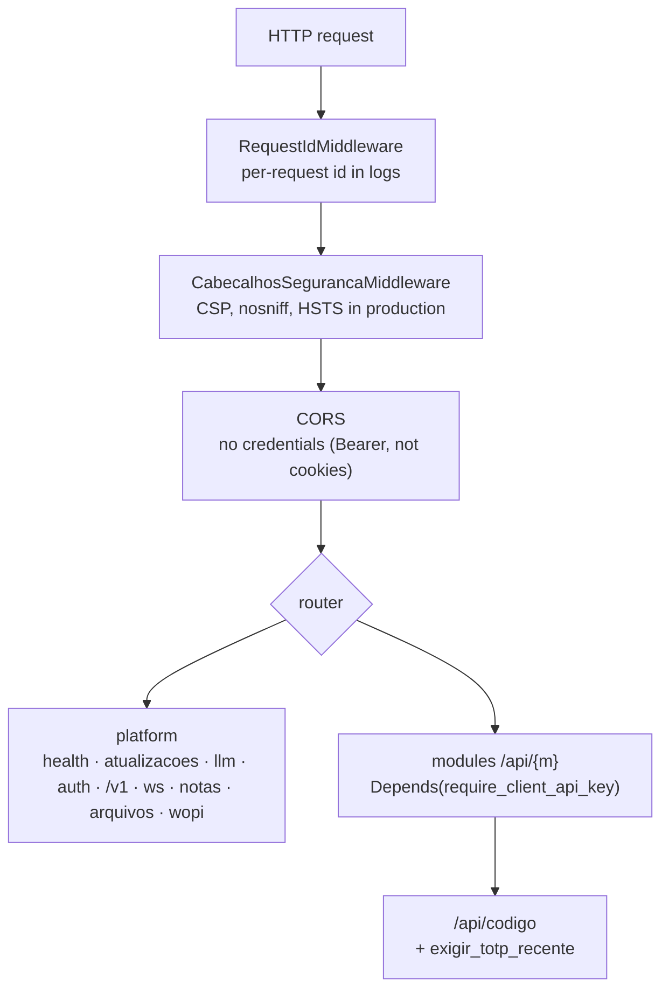
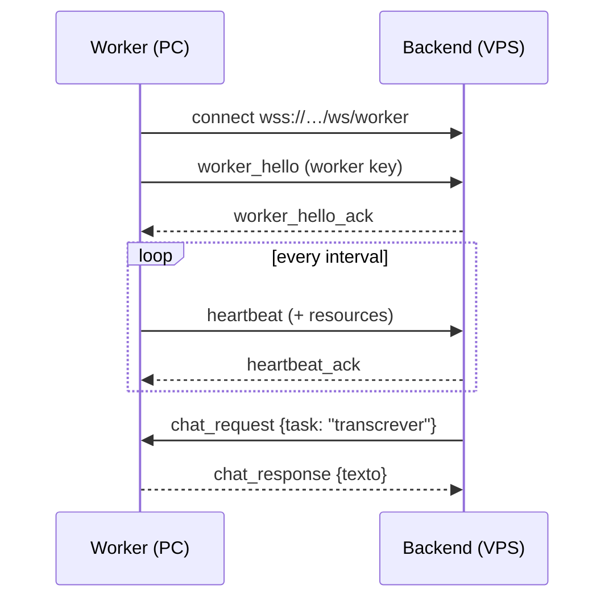

[README](../../README.md) · [Local models](local-models.md) · [Cloud LLMs](cloud-llms.md) · **Backend** · [Frontend](frontend.md) · [Security](security.md) · [Network](network.md) · [Data](data.md) · [DevOps](devops.md) · [Modules](modules.md)

# Backend

Two processes: the FastAPI **backend** on the VPS (`plataforma/backend`), always online, and the **worker** on
the PC (`plataforma/worker`), which executes anything that needs the GPU or the home machine. They talk over a
WebSocket opened by the worker, using the protocol in `plataforma/shared`.

## Application assembly (`backend/main.py`)

Errors always use the OpenAI shape `{"error": {"message", "type"}}`; unhandled exceptions become a generic 500
and details go to the log only.

## Routes

| Prefix | Source | Purpose |
|---|---|---|
| `/health` | `api/health.py` | backend and worker health |
| `/auth/*` | `auth/api.py` | login (password + TOTP), renew, confirm TOTP, sign out everywhere, media token |
| `/v1/*` | `api/v1/` | OpenAI-compatible LLM (`/v1/models`, `/v1/chat/completions`) |
| `/ws/worker` | `api/ws/worker.py` | worker WebSocket |
| `/api/llm` | `api/llm.py` | list and switch the local model |
| `/api/atualizacoes` | `api/atualizacoes.py` | published app builds |
| `/api/notas` | `notas/` | Markdown + YAML notes from the vault (Obsidian-compatible) |
| `/api/arquivos`, WOPI | `arquivos/` | library, rewriting, citation mapping, WOPI host for Collabora |
| `/api/<module>` | `modulos/<m>/backend` | saude, estudos, rotinas, concursos, vagas, financas, design, eletronica, codigo, painel, youtube |

## Module contract

- **Backend:** `modulos/<m>/backend` is a uv workspace package (`agent-<m>`) exposing an `APIRouter`; the
  platform mounts it at `/api/<m>` with the authentication dependency.
- **Worker:** the module registers tasks by name; the worker receives them over the WebSocket and dispatches.
- **App:** `modulos/<m>/app` is a Flutter package (`agent_<m>`) exporting a `Modulo` (see [Frontend](frontend.md)).

## WebSocket protocol (`shared/protocol.py`)

Every message is a JSON object with a `type` field (a pydantic discriminated union).

| `type` | Direction | Purpose |
|---|---|---|
| `worker_hello` / `worker_hello_ack` | worker to VPS / VPS to worker | handshake and worker key authentication |
| `heartbeat` / `heartbeat_ack` | both | liveness plus PC resources (CPU, RAM, GPU) |
| `chat_request` / `chat_response` | VPS to worker / worker to VPS | chat and **tasks** (`payload.task`) |
| `evento` | worker to VPS | progress events |
| `error` | both | protocol or worker error |

### Worker tasks (`ws_client.py`)

| Task | Executor |
|---|---|
| chat | `providers/llamacpp.py` |
| `transcrever`, `falar`, `falar_marcado`, `avaliar_leitura` | `voz.py` (speech) |
| Código tasks | `codigo.py` |
| `contas.listar`, `contas.ativar`, `contas.entrar`, `contas.codigo`, `contas.remover` | `contas_claude.py` |
| PC commands (e.g. shutdown) | `pc.py` |
| `carregar_modelo`, `listar_modelos` | llama.cpp |
| `simular_spice` | `shared/ngspice.py` |
| `reescrever`, `claude_json` | `shared/claude_code.py` |

## Video pipeline API

`modulos/empreendimento/esteira` has its own FastAPI app (`esteira/web/app.py`, `/api/v1`, port 8765) plus the
htmx visual editor. It runs on the PC and is exposed to the VPS through a reverse SSH tunnel (see
[Network](network.md)); the VPS checks the app session before forwarding (`/auth/verificar`).

## Tests

`plataforma/backend/tests`, `plataforma/worker/tests`, `modulos/empreendimento/esteira/tests`. Run them with
`infra/scripts/verificar` (changed files only).
