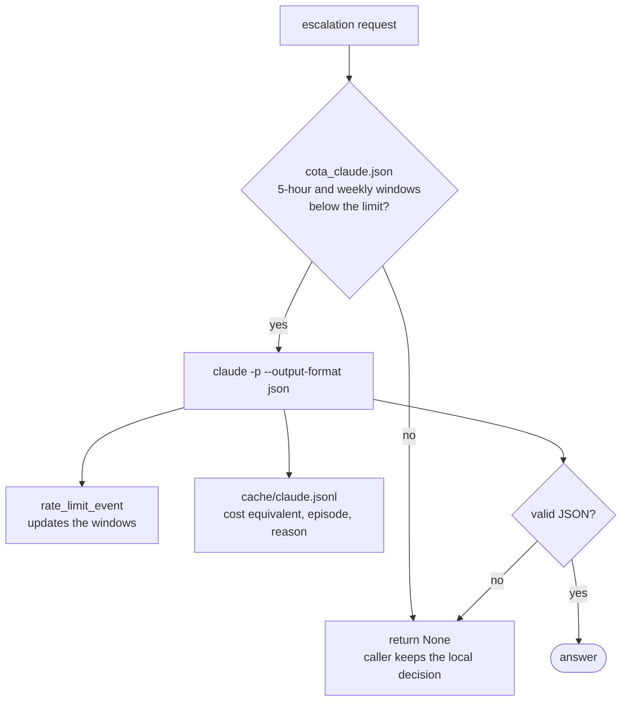
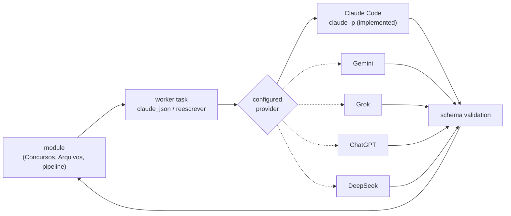

[README](../../README.md) · [Local models](local-models.md) · **Cloud LLMs** · [Backend](backend.md) · [Frontend](frontend.md) · [Security](security.md) · [Network](network.md) · [Data](data.md) · [DevOps](devops.md) · [Modules](modules.md)

# Cloud LLMs

Language models that run **outside the home network**. Today the only provider is **Claude**, used through
**headless Claude Code** (`claude -p`) with the subscription logged in on the PC, **never through the paid
Anthropic API** (no `anthropic` SDK, no API key). The layer is designed so that other providers (Gemini, Grok,
ChatGPT, DeepSeek) can be added without changing any caller.

## Current implementation: Claude Code

| Part | Location | Role |
|---|---|---|
| Generic client | `plataforma/shared/src/shared/claude_code.py` | `claude_json`: prompt + schema to validated JSON; `reescrever`: academic rewriting by goal (advisor review, formal, translate, concise, expand, grammar) |
| Worker tasks | `plataforma/worker/src/worker/ws_client.py` | `claude_json` and `reescrever` tasks arrive over the WebSocket and run on the PC |
| Accounts | `plataforma/worker/src/worker/contas_claude.py` | several accounts (one `CLAUDE_CONFIG_DIR` each), switched from the app when one hits its usage window; login via `claude auth login` in a pseudo-terminal, authorized from any device |
| Coding agent | `plataforma/worker/src/worker/codigo.py` + **Código** module | Claude Code with tools, inside this repository, in resumable tabs (`--resume`) |
| Pipeline escalation | `modulos/empreendimento/esteira/esteira/ia/claude.py` | only for what code and the local LLM could not settle; compact dossier in, JSON out |

**Isolation of headless calls:** no tools, no saved session, and no project `CLAUDE.md` or settings are read,
so the answer depends on the prompt alone.

### Quota guard



The recorded "cost" is the API-price equivalent reported by `claude -p`, used only as a **consumption metric**
(shown in the **Painel** module); the actual limit is the subscription quota.

## Adding another provider

Every cloud provider must honor the same contract as `claude_code.py`:

```
input:    prompt (text) + JSON schema (or a rewriting goal)
output:   dict validated against the schema  |  None (unavailable, over quota, invalid answer)
effects:  one consumption record (provider, model, cost equivalent, reason)
```



*Dashed lines are planned providers, not yet implemented.*

| Provider | Integration path | Notes |
|---|---|---|
| **Claude** (current) | `claude -p` CLI with the subscription | project rule: never the Anthropic API |
| **Gemini** | Google's headless CLI where available, or the API with a key in the worker `.env` | check free-tier quota and data-retention policy |
| **ChatGPT** | OpenAI's headless CLI where available, or the API with a key | OpenAI-compatible format, the same one the gateway exposes at `/v1` |
| **Grok** | xAI's OpenAI-compatible API | key on the worker only, never in the app |
| **DeepSeek** | OpenAI-compatible API, or open weights as GGUF through [local models](local-models.md) | the local option keeps data at home |

Rules for any new provider:

1. **Runs on the worker (PC)**, never in the app; keys live only in the worker `.env` (see [Security](security.md)).
2. **Same contract** (schema in, JSON or `None` out), so providers can be swapped without touching modules.
3. **Its own guard** (quota or cost per window) and consumption records feeding the Painel.
4. **Sensitive data** (finances, health, personal notes) stays on local models unless an explicit decision says otherwise.
5. The choice is recorded as a decision in [ARCHITECTURE.md](../ARCHITECTURE.md) using the ADR format
   (context, decision, consequences; Nygard, 2011).

## Where cloud LLMs are used today

| Module | Use |
|---|---|
| Empreendimento | curation and script escalation in the pipeline |
| Arquivos | academic rewriting and citation mapping |
| Concursos | study plan generated from the exam notice (`claude_json`) |
| Código | coding agent inside the repository (with tools) |
