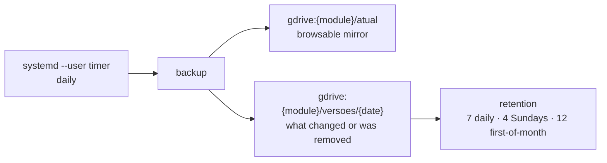

[README](../../README.md) · [Local models](local-models.md) · [Cloud LLMs](cloud-llms.md) · [Backend](backend.md) · [Frontend](frontend.md) · [Security](security.md) · [Network](network.md) · **Data** · [DevOps](devops.md) · [Modules](modules.md)

# Data and backup

**Data lives in files, with no central database.** Each module stores its own data in `$AGENT_DATA/<module>/`
(default `~/agent-data`), outside git (D9).

| Format | Use |
|---|---|
| JSON | per-module state (tasks, finances, studies, whiteboards) |
| JSONL | append-only history (Código sessions, traces, LLM caches, datasets) |
| Markdown + YAML front matter | **notes**, Obsidian-compatible (`/api/notas`, `backend/notas/cofre.py`) |
| SQLite | **rebuildable indexes only**: media library (FTS5) and pipeline dataset |

```
~/agent-data/
  empreendimento/  projetos/ · acervo/ (SQLite FTS5) · dataset/ · cache/
  arquivos/<id>/   original, ink strokes, highlights
  estudos/ saude/ rotinas/ design/quadros/ eletronica/ codigo/sessoes/
  concursos/ financas/ painel/
  modelos/         .gguf files, folders with mmproj, LoRA adapters
```

## Obsidian vault

The vault is a separate repository and the **source of truth** for knowledge and content modules: scripts,
channels, themes and methods for Empreendimento (`python -m youtube.importar`), and notes for Estudos.

## Backup (`infra/scripts/backup`)



- rclone with a `gdrive` remote (own OAuth client).
- The Drive copy is **read-only**: edits made there are reverted on the next run (and moved to `versoes/`).
- Install with `infra/scripts/backup --instalar`.

## Principles

- Rebuildable over consistent: SQLite indexes can be deleted and rebuilt from the files.
- Heavy data (video projects, media library, models) can move to an external drive by changing `AGENT_DATA`.
- Single user, but structures carry the user where it matters (D13).
- Training datasets are documented as *datasheets* (Gebru et al., 2021): origin, filters, purpose.
