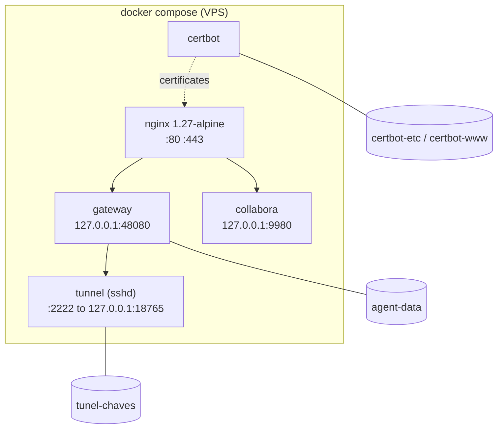
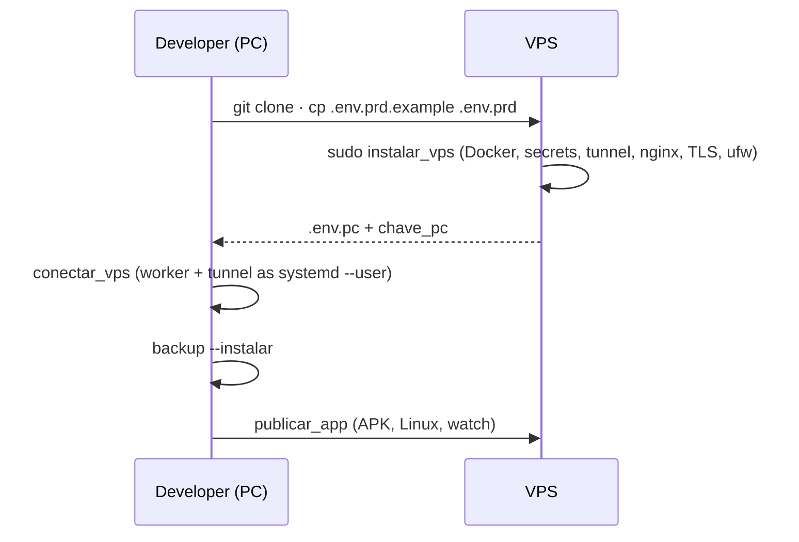

[README](../../README.md) · [Local models](local-models.md) · [Cloud LLMs](cloud-llms.md) · [Backend](backend.md) · [Frontend](frontend.md) · [Security](security.md) · [Network](network.md) · [Data](data.md) · **DevOps** · [Modules](modules.md)

# DevOps

## Environments

| Environment | Where | How it starts |
|---|---|---|
| Development | PC | `uv sync --all-packages`, `flutter run`, `./dark painel` |
| VPS | Ubuntu/Debian + Docker | `sudo infra/scripts/instalar_vps` |
| PC (production) | systemd `--user` | `infra/scripts/conectar_vps` |
| Apps | phone, watch, Linux | `infra/scripts/publicar_app` |

## Docker Compose (`infra/docker/docker-compose.yml`)



## Deployment



`instalar_vps` is **idempotent**: re-running it reuses secrets, keys and certificates and only rebuilds and
restarts. Collabora and certbot images are **pinned by digest** in `infra/docker/imagens.env` (delete the file
and re-run to upgrade on purpose). Subsequent updates: `infra/scripts/atualizar_vps`.

## Scripts (`infra/scripts/`)

| Script | Purpose |
|---|---|
| `instalar_vps` / `atualizar_vps` | VPS installation and update |
| `conectar_vps` | worker and tunnel services on the PC |
| `backup` | Google Drive backup (rclone) with retention |
| `publicar_app` | builds with `BUILD=<minutes since 1970>` and publishes for the in-app update button |
| `empacotar_linux` | desktop app packaging |
| `instalar_xtts` | XTTS-v2 speech environment |
| `run_gateway`, `run_worker`, `llm_gateway` (`.sh`/`.ps1`) | local runs |
| `verificar` | **standard validation**: ruff, pytest and `flutter analyze` on changed files only, compact output |

## Validation and quality

```sh
infra/scripts/verificar                 # everything changed since HEAD
infra/scripts/verificar <path>...       # explicit scope
```

- Python: ruff + pytest (uv workspace); the pipeline has its own venv (CUDA, torch), outside the workspace (D2).
- Flutter: `flutter analyze` (SDK at `~/development/flutter`).
- **No CI yet** (`.github/workflows`): the natural next step is running `verificar` on every push.

## Observability

- `RequestIdMiddleware`: per-request id in backend logs.
- Worker heartbeat with CPU, RAM and GPU load.
- Painel module: LLM usage, pipeline traces and push alerts (ntfy).
