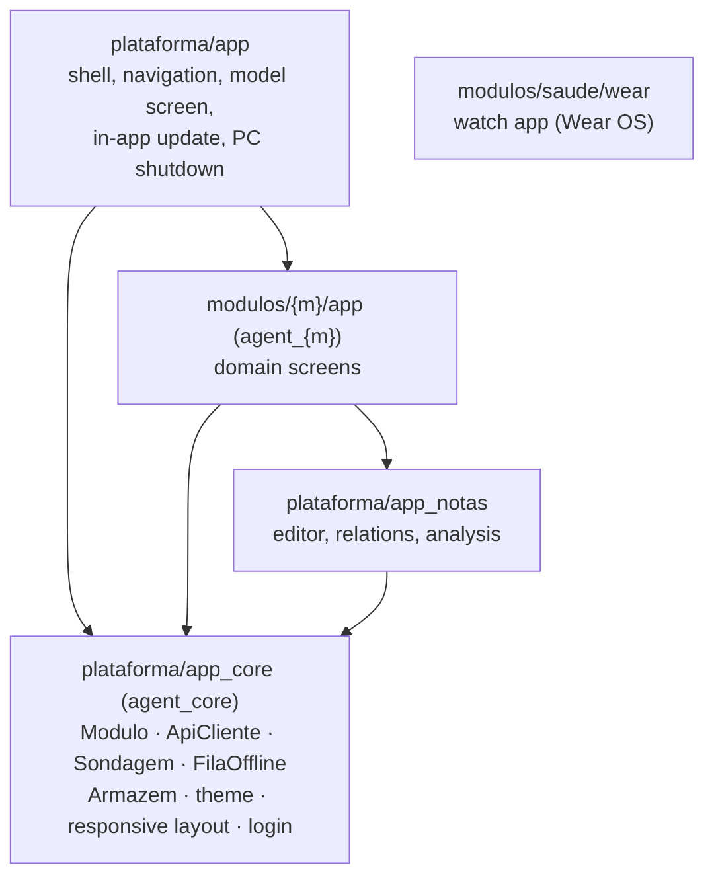
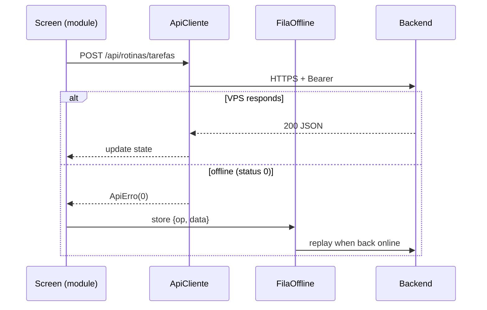

[README](../../README.md) · [Local models](local-models.md) · [Cloud LLMs](cloud-llms.md) · [Backend](backend.md) · **Frontend** · [Security](security.md) · [Network](network.md) · [Data](data.md) · [DevOps](devops.md) · [Modules](modules.md)

# Frontend

**Flutter for every interface** (decision D1): Android, Linux desktop, web and tablet share one codebase. The
watch has its own Wear OS app. The pipeline's htmx panel remains online only for the visual editor
(temporary exception D1a).

## Packages

All packages belong to a **pub workspace** at the repository root (`flutter pub get` at the root). Each module
exports a `Modulo` subclass (`app_core/lib/src/modulo.dart`: name, icon, routes), and the main app collects
them in `plataforma/app/lib/modulos.dart`.

## `app_core` building blocks

| File | Role |
|---|---|
| `api.dart` | `ApiCliente`: Bearer auth and errors (`ApiErro`; `status == 0` means offline) |
| `login.dart` | login screen (user, password, authenticator code, "keep me signed in") |
| `sondagem.dart` | `Sondagem<T>`: periodic fetch with `ErroComRetry` |
| `fila_offline.dart` | operations made offline, stored and replayed in order when the VPS is back |
| `armazem*.dart` | local storage (disk on `io`, in-memory for tests) |
| `aparelho*`, `microfone*`, `tocador*` | conditional `io`/`web` imports for platform features |
| `abas.dart`, `responsivo.dart`, `filtros_recolhiveis.dart` | phone, tablet and desktop layouts |
| `markdown.dart`, `campo_markdown.dart` | Markdown rendering and editing |
| `leitura_voz.dart` | read-aloud through the worker (TTS) |
| `tema.dart`, `seletor_cor.dart` | theme and colors |

## Screen data flow

## In-app updates

`infra/scripts/publicar_app` builds the APK, the Linux app and the watch app with
`--dart-define=BUILD=<minutes since 1970>` and publishes them to the VPS; the app compares against
`/api/atualizacoes` and offers an **update** button (`plataforma/app/lib/atualizacao.dart`, `ota_update` on
Android). Build `0` (development) never offers to update itself.

## Native code (Android and watch)

- `plataforma/app/android/.../consumo/ConsumoPlugin.kt`: app usage reading (`PACKAGE_USAGE_STATS`) for the
  Saúde module. Read-only; see the VPN decision in [Network](network.md#vpn).
- Rule: phone and watch features **work in the background**, never depending on an open screen.
- Native code is not covered by `infra/scripts/verificar`; it requires an on-device build.

## Conventions

- UI strings and identifiers follow the codebase language (Portuguese).
- Modules with non-obvious structure carry their own `CLAUDE.md` (`modulos/*/app/CLAUDE.md`).
- Validation: `flutter analyze` through `infra/scripts/verificar`.
