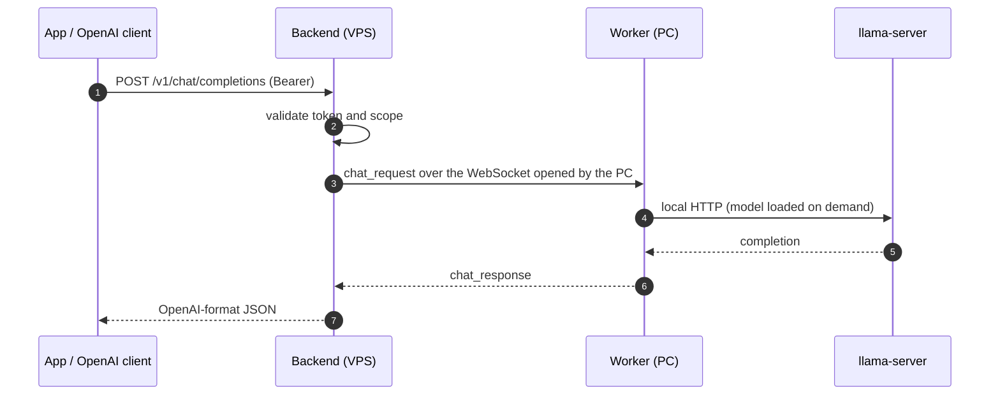
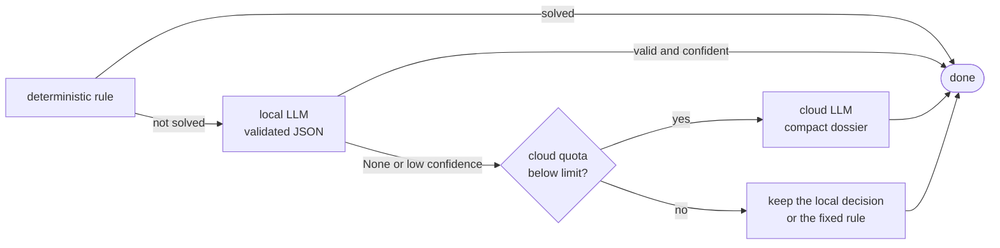

[README](../../README.md) · **Local models** · [Cloud LLMs](cloud-llms.md) · [Backend](backend.md) · [Frontend](frontend.md) · [Security](security.md) · [Network](network.md) · [Data](data.md) · [DevOps](devops.md) · [Modules](modules.md)

# Local models

Everything that runs **on the home GPU** (RTX 5060 Ti, 16 GB) at no per-token cost and without sending data
off the machine. This layer is broader than "a local LLM": it also covers speech recognition, speech
synthesis, image diffusion and embedding models. It is the default path; [cloud LLMs](cloud-llms.md) are used
only when local inference cannot answer with confidence.

## Components

| Component | Location | Role |
|---|---|---|
| `llama-server` (llama.cpp) in **router mode** | `plataforma/worker/src/worker/providers/llamacpp.py`, `modulos/empreendimento/esteira/esteira/ia/llama.py` | one server serves every `.gguf` model in `~/agent-data/modelos`; loads on demand and unloads when idle |
| Structured-output LLM calls | `esteira/ia/local.py` | `perguntar(prompt, Modelo)` returns a pydantic instance or `None` after two attempts; cached in `cache/llm.jsonl` |
| Embeddings | `esteira/ia/embeddings.py` | EmbeddingGemma 300M on a dedicated `llama-server --embeddings` on the CPU (port 8082) |
| LoRA fine-tuning | `esteira/ia/treinar_lora.py` | trains adapters from approved outputs (unsloth + trl); one adapter per Craft App, loaded on top of the base model |
| Speech-to-text | `plataforma/worker/src/worker/voz.py` | faster-whisper on the GPU, with a filter for typical Whisper hallucinations |
| Text-to-speech | `plataforma/worker/xtts/servidor.py`, `voz.py` | XTTS-v2; fallbacks Kokoro (per-language voices), Piper and espeak-ng |
| Image generation | pipeline (`thumbs.py`, `imagem/`) | RealVisXL / SDXL for thumbnails |
| Circuit simulation | `plataforma/shared/src/shared/ngspice.py` | ngspice on the worker (not AI, but uses the same task queue) |

## Models and what they are used for

Models live in `~/agent-data/modelos` (outside git) and are switched from the app's **Modelo de IA** screen
(`/api/llm`). Currently installed examples:

| Family | Typical use |
|---|---|
| Qwen3 14B, Qwen3.6 35B-A3B (MoE) | general chat, JSON extraction, categorization (Finanças, Concursos, Cobrador) |
| Gemma 4 12B / 26B-A4B | scripting, curation and pipeline decisions; base model for LoRA adapters |
| GPT-OSS 20B | longer reasoning |
| Qwen2.5-VL 7B (folder with `mmproj-*`) | vision: describing images and whiteboards |
| EmbeddingGemma 300M | semantic search and studio direction |

Convention: a standalone `.gguf` becomes a model id (file name without extension); a **folder** holding the
model and its `mmproj-*` becomes a vision model (id = folder name).

## Chat request flow

## GPU sharing rules

- **One heavy job at a time** (`core/locks.py` in the pipeline): Whisper, SDXL and the LLM never compete for
  VRAM. `liberar_gpu()` unloads models before Whisper and diffusion.
- `llama-server` is **shared** between the worker and the pipeline (whoever starts first launches it) and
  outlives the worker.
- **Switching models is rejected with 409** while any client is using the LLM.
- The worker reports CPU, RAM and GPU load with every heartbeat (`worker/recursos.py`, via `nvidia-smi`), shown
  in the app.

## Escalation from local to cloud

Escalation details: [Cloud LLMs](cloud-llms.md).

## Practices

- **Structured output only.** Prompt plus pydantic schema; an invalid answer counts as a failure and is never
  patched.
- **Hash-keyed cache** (model + prompt + schema): re-running a step does not repeat calls.
- **Models are documented artifacts.** For every LoRA adapter or new model, record base model, training data,
  task, metrics and limitations, following *Model Cards* (Mitchell et al., 2019) and *Datasheets for Datasets*
  (Gebru et al., 2021). See [references](about.md#references).
