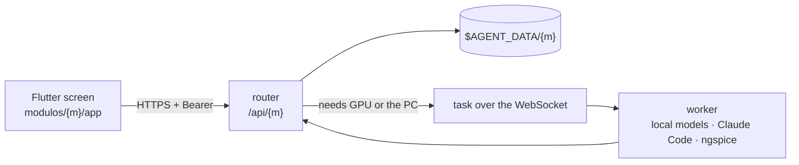

[README](../../README.md) · [Local models](local-models.md) · [Cloud LLMs](cloud-llms.md) · [Backend](backend.md) · [Frontend](frontend.md) · [Security](security.md) · [Network](network.md) · [Data](data.md) · [DevOps](devops.md) · **Modules**

# Modules by layer

Each module described by the layers it touches. The module README (`modulos/<m>/README.md`) holds route-level
detail.

## Matrix

| Module | Backend | Frontend | Local models | Cloud LLM | Data | Specific security |
|---|---|---|---|---|---|---|
| [Empreendimento](../../modulos/empreendimento/README.md) (YouTube) | pipeline `/api/v1` (PC) + `/api/youtube` | production, scripts, queue, machine, episode | llama.cpp, Whisper, SDXL, embeddings, LoRA | escalation with quota guard | projects, FTS5 media library, dataset | pipeline reachable only through the tunnel + session |
| [Arquivos](../../modulos/arquivos/README.md) (files) | `backend/arquivos` (platform) + WOPI | library, ink, reader | — | rewriting, citations | `arquivos/<id>/` | signed WOPI tokens |
| [Estudos](../../modulos/estudos/README.md) (studies) | `/api/estudos` | readings, languages, notes | TTS and reading assessment | — | `estudos/*.json` + notes | — |
| [Saúde](../../modulos/saude/README.md) (health) | `/api/saude` | workouts, habits, focus, journal, screen time | — | — | `saude/` | scoped watch key; no VPN or accessibility service |
| [Rotinas](../../modulos/rotinas/README.md) (routines) | `/api/rotinas` | Kanban + timer | — | — | `rotinas/tarefas.json` | — |
| [Design](../../modulos/design/README.md) | `/api/design` | whiteboard, pen, notebooks | LLM (flowchart structure) | — | `design/quadros/` | — |
| [Eletrônica](../../modulos/eletronica/README.md) (electronics) | `/api/eletronica` + simulation | circuit CAD | ngspice on the worker | — | `eletronica/` | — |
| [Código](../../modulos/codigo/README.md) (code) | `/api/codigo` | session tabs | — | Claude Code with tools | `codigo/sessoes/` (JSONL) | **recent TOTP required** |
| [Concursos](../../modulos/concursos/README.md) (public exams) | `/api/concursos`, `/api/vagas` | notices, plan, radar, résumés | local LLM | study plan (`claude_json`) | `concursos/` | — |
| [Finanças](../../modulos/financas/README.md) (finance) | `/api/financas` | statements, 50/30/20, scenarios, CVM | LLM (statements, scenarios) | none (sensitive data) | `financas/*.json` | data stays local |
| [Painel](../../modulos/painel/README.md) (dashboard) | `/api/painel` | LLM usage, Cobrador, agenda | LLM (Cobrador agent), speech | — | `painel/` | watch scope limited to its own routes |

## Typical module flow

## Adding a module

1. `modulos/<m>/backend`: uv workspace package `agent-<m>` with an `APIRouter`; mount it in `backend/main.py`
   with `Depends(require_client_api_key)`.
2. `modulos/<m>/app`: Flutter package `agent_<m>` with a `Modulo` subclass; register it in
   `plataforma/app/lib/modulos.dart`.
3. If it needs the PC: add a task to `worker/ws_client.py`.
4. Store data under `$AGENT_DATA/<m>/` and include it in the backup.
5. Write the module `README.md` and add a row to this matrix.
