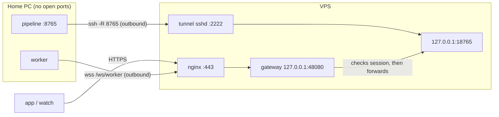

[README](../../README.md) · [Local models](local-models.md) · [Cloud LLMs](cloud-llms.md) · [Backend](backend.md) · [Frontend](frontend.md) · [Security](security.md) · **Network** · [Data](data.md) · [DevOps](devops.md) · [Modules](modules.md)

# Network

Core rule (D4): **the VPS never initiates a connection to the home network.** Every channel between the two is
opened by the PC.

## Channels

| Channel | Opened by | Carries |
|---|---|---|
| HTTPS (app, watch, OpenAI clients) | client to nginx | API, `/v1`, notes, media |
| WebSocket `/ws/worker` | **worker** to VPS | chat, tasks, events, heartbeat |
| Reverse SSH tunnel | **PC** to VPS (`:2222`) | the pipeline API (`:8765`) |
| Collabora (WOPI) | Collabora to backend, inside the VPS | document reads and writes |

The PC's systemd `--user` services (installed by `infra/scripts/conectar_vps`) keep the worker and tunnel up
and reconnect automatically.

## Real client IP and Cloudflare

`infra/docker/nginx/seguranca-http.conf` trusts `CF-Connecting-IP` only when the connection comes from
**Cloudflare's published ranges**; without Cloudflare, the connection IP is used. The site forwards that IP in
`X-Forwarded-For` (without appending client-supplied values), and the gateway uses it for login brute-force
lockout.

## VPN

- **There is no VPN between home and the VPS.** The original WireGuard plan was replaced by the outbound
  WebSocket inherited from `llm_gateway` (D4): fewer moving parts, no open port at home, and authentication by
  worker key.
- **On the phone**, the Saúde module used to rely on a *local DNS VPN* (site blocking), the accessibility
  service and device administrator. **These were removed** after a banking app started flagging the app as
  suspicious. The only permission left is usage access (`PACKAGE_USAGE_STATS`); the "VPN/bypass" category
  remains purely as a **screen-time** category, with no on-device blocking.

## Ports

| Port | Where | Exposed |
|---|---|---|
| 80 / 443 | nginx | yes (TLS via certbot) |
| 2222 (`TUNEL_PORTA`) | tunnel sshd | yes, key-only |
| 48080 | gateway | no (`127.0.0.1`) |
| 9980 | Collabora | no (`127.0.0.1`) |
| 18765 | tunneled pipeline | no (`127.0.0.1`) |
| 8765 / 8082 / llama-server | PC | local only |
