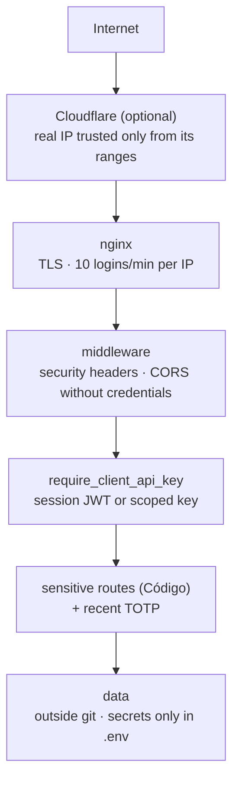
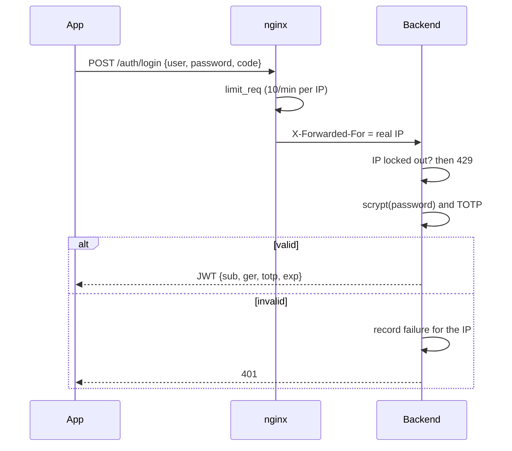

[README](../../README.md) · [Local models](local-models.md) · [Cloud LLMs](cloud-llms.md) · [Backend](backend.md) · [Frontend](frontend.md) · **Security** · [Network](network.md) · [Data](data.md) · [DevOps](devops.md) · [Modules](modules.md)

# Security

A **single-user** system exposed to the internet. Defense is layered (edge, API, route, data) and
**fail-secure**: with no key or login configured, every request is denied. To report a vulnerability, see
[SECURITY.md](../../SECURITY.md).

## Defense in depth

## Authentication (`plataforma/backend/src/backend/auth/`)

| Mechanism | Implementation |
|---|---|
| Password | **scrypt** (N=2^14, r=8, p=1, about 16 MiB per check), constant-time comparison |
| Second factor | **TOTP** (Google Authenticator), six-digit code required at login |
| Session | **JWT HS256** built on the standard library only; secret of at least 32 bytes |
| "Keep me signed in" | long validity (`jwt_lembrar_dias`) instead of `jwt_expire_minutes` |
| Revocation | **generation** claim (`ger`): "sign out everywhere" bumps the generation and invalidates all tokens |
| Media token | scoped token (`esc`) valid only for media files; it **cannot open the API** |
| Brute force | per-IP lockout after failures (`Tentativas`) plus nginx `limit_req` (10/min, burst 5) |
| PC commands | `/api/codigo` requires a TOTP entered within the last `codigo_totp_horas` |

Generate the password hash, TOTP secret and JWT key: `.venv/bin/python -m backend.auth.seguranca`.

## Scoped client keys

`GATEWAY_CLIENT_API_KEYS` accepts `scope:key`. A key without a scope has full access (OpenAI-compatible tools
on `/v1`); a `relogio` (watch) key reaches only Saúde, selected Painel routes (discipline, agenda, voice,
speak) and updates. Keys are **all** compared in constant time, without stopping at the first match.

## Headers and CORS (`middleware/cabecalhos.py`)

`X-Content-Type-Options: nosniff`, `X-Frame-Options: DENY`, `Referrer-Policy: no-referrer`,
`Content-Security-Policy: default-src 'none'; frame-ancestors 'none'`, a `Permissions-Policy` denying camera,
microphone and geolocation, `Cross-Origin-Opener-Policy: same-origin`, `Cache-Control: no-store` on `/api` and
`/v1`, and **HSTS** in production. CORS uses `allow_credentials=False` because authentication travels in a
Bearer header, not in cookies.

## Network surface

| Point | Protection |
|---|---|
| Home PC | **no open ports**: worker and tunnel are outbound |
| SSH tunnel (`infra/docker/tunel/sshd_config`) | key-only, no password, no TTY, `ForceCommand /bin/false`, `PermitOpen none`, only the reverse forward of port 8765; the PC key is `restrict` |
| Internal ports | gateway, Collabora and the tunneled pipeline listen on `127.0.0.1` only |
| Firewall | `instalar_vps` opens only 80, 443 and the tunnel port in ufw |
| Docker images | Collabora and certbot **pinned by digest** (`infra/docker/imagens.env`) |
| Collabora | signed, time-limited WOPI tokens (`wopi_token_minutos`) |

Details in [Network](network.md).

## Secrets

- `.env` files are never committed; every package ships an `.env.example` with names and formats only.
- `instalar_vps` generates and reuses secrets; `.env.pc` (holding the worker key) is not versioned.
- Keys for future cloud providers live on the worker only ([Cloud LLMs](cloud-llms.md)).

## Threat model (STRIDE summary)

| Threat | Example | Mitigation |
|---|---|---|
| **S**poofing | leaked password | mandatory TOTP; revocation by generation |
| **T**ampering | forged token | HMAC signature; `compare_digest` |
| **R**epudiation | "who issued this command?" | `RequestIdMiddleware` and logs |
| **I**nformation disclosure | cached responses, clickjacking | `no-store`, CSP, `X-Frame-Options` |
| **D**enial of service | login brute force | `limit_req` and per-IP lockout |
| **E**levation of privilege | watch key calling `/api/codigo` | per-key scopes; recent TOTP for Código |

Audit reference: OWASP ASVS, levels 1 and 2.
